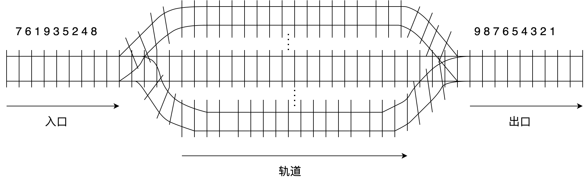

# Lab10：栈与队列——408 历年真题选择练习

> **作业目标**：通过 14 道 408 历年真题（2009–2025）选择题，巩固栈与队列一章的核心内容：出入栈序列的判定与栈容量分析、双端队列、函数调用栈、打印缓冲区、火车重排与括号匹配。请先独立作答，再对照课程统一发布的答案与解析核对订正；涉及序列可行性的题目，建议在草稿纸上逐步画出栈或队列的变化过程。
>
> 本次为纯书面作业，不要求编写程序、不要求截图。中缀表达式转后缀表达式、循环队列相关的题目均不在本次范围内。
>
> **审核说明**：本次 PR 自动审核会检查 `Lab10.md` 与题图文件是否存在、题图是否被改动，以及每道选择题是否恰好勾选一个选项。自动审核不判断所选选项是否正确，内容正确性将在期末统一检测。空文件、未作答的模板或删改题目、选项的文件不能通过本次审核。

---

## 一、作答说明
1. 全卷共 14 道单项选择题，按考点分为三组；题号后的括号内为真题年份，便于对照历年真题复习。
2. 作答时将所选选项前的 `[ ]` 改为 `[x]`，每题只能勾选一项；不要删除其他选项，不要改动题面、选项顺序和题图。
3. 答案与解析不在本文件中，由课程统一发布；先独立完成，再核对订正。
4. 判断"可能 / 不可能得到某序列"的题目，建议在草稿纸上模拟每一步入栈、出栈（或入队、出队）操作，记录容器在每一步的状态后再下结论。
5. 本次不涉及编程、不涉及截图，也不需要运行任何程序。

---


## 二、栈与出入栈序列（题 1～7）

### 题 1（2009 年）
- [ ] A. 1
- [ ] B. 2
- [x] C. 3
- [ ] D. 4

### 题 2（2010 年）
- [ ] A. d, c, e, b, f, a
- [ ] B. c, b, d, a, e, f
- [ ] C. b, c, a, e, f, d
- [x] D. a, f, e, d, c, b

### 题 3（2011 年）
- [ ] A. 3
- [ ] B. 4
- [x] C. 5
- [ ] D. 6

### 题 4（2013 年）
- [ ] A. n−3
- [x] B. n−2
- [ ] C. n−1
- [ ] D. 无法确定

### 题 5（2017 年）
- [ ] A. 仅 I
- [ ] B. 仅 I、II、III
- [x] C. 仅 I、III、IV
- [ ] D. 仅 II、III、IV

### 题 6（2020 年）
- [ ] A. b, a, c
- [ ] B. b, a, e
- [ ] C. b, c, a
- [x] D. b, c, e

### 题 7（2022 年）
- [ ] A. 若 in 是 ST 的入栈序列，则不能判断 out 是否为其可能的出栈序列
- [ ] B. 若 out 是 ST 的出栈序列，则不能判断 in 是否为其可能的入栈序列
- [ ] C. 若 in 是 ST 的入栈序列，out 是对应 in 的出栈序列，则 in 与 out 一定不同
- [x] D. 若 in 是 ST 的入栈序列，out 是对应 in 的出栈序列，则 in 与 out 可能互为倒序

---

## 三、队列与双端队列（题 8～10）

### 题 8（2009 年）
- [ ] A. 栈
- [x] B. 队列
- [ ] C. 树
- [ ] D. 图

### 题 9（2010 年）
- [ ] A. b, a, c, d, e
- [ ] B. d, b, a, c, e
- [ ] C. d, b, c, a, e
- [x] D. e, c, b, a, d

### 题 10（2021 年）
- [x] A. 5, 4, 3, 1, 2
- [ ] B. 5, 3, 1, 2, 4
- [ ] C. 4, 2, 1, 3, 5
- [ ] D. 4, 1, 3, 2, 5

---

## 四、栈与队列的应用（题 11～14）

### 题 11（2016 年）

- [ ] A. 2
- [ ] B. 3
- [x] C. 4
- [ ] D. 5

### 题 12（2018 年）
- [ ] A. 1, 2, 5, 6, 4, 3
- [ ] B. 2, 3, 4, 5, 6, 1
- [x] C. 3, 4, 5, 6, 1, 2
- [ ] D. 6, 5, 4, 3, 2, 1

### 题 13（2015 年）
- [x] A. main() → S(1) → S(0)
- [ ] B. S(0) → S(1) → main()
- [ ] C. main() → S(0) → S(1)
- [ ] D. S(1) → S(0) → main()

### 题 14（2025 年）
- [ ] A. (a+[b+(c+d)e]+f)+g-h
- [ ] B. [a*((b+c)/(d-e)+f/g)]-h
- [ ] C. [a*(b-(c-d)*e/(f+g))-h]
- [x] D. [a-(b+[c*(d+e)-f]+g+h)]

---

## 五、提交要求

将本文件复制到自己的 `学号姓名/Lab10/Lab10.md`，完成全部选择题作答。最终只提交以下两个文件：

```text
学号姓名/
└── Lab10/
    ├── Lab10.md
    └── imgs/
        └── 2016_q3_stem1.png
```

- `imgs/2016_q3_stem1.png` 是题 11 的题图，须从 `homework/Lab10/imgs/` 原样复制，不得修改、重命名或替换；缺少该文件时题 11 的题图无法显示。
- 每道单项选择题必须且只能将一个选项的 `[ ]` 改为 `[x]`，不能全部不选，也不能同时选择多项。
- `Lab10.md` 必须保留全部 14 道题目与全部选项，不要改动题面和题图引用路径。
- 答案与解析由课程统一发布，提交的文件中不要自行添加答案。
- 不需要提交程序、截图、`CMakeLists.txt`、`cmake-build-*`、`.idea/`、`.exe` 或其他编译产物。
- `Lab10`、`Lab10.md` 的大小写必须完全一致。
- PR 标题必须严格使用 `[学号姓名]Lab10作业提交`，右方括号后不能有空格。
- 一个 PR 只能包含本次 Lab10 的文件，不得修改其他同学、`homework/`、README 或仓库配置。

---
## 六、截止时间
**2026 年 10 月 21 日 24:00（即 2026 年 10 月 22 日 00:00，北京时间）**

以 GitHub 记录的最后一次向 PR 推送代码的时间为准。不晚于上述时刻创建 PR 并完成最后一次推送不算超时；超过该时刻新建 PR，或向已有 PR 推送任何修改，均算作超时。审核未通过的同学请在截止前完成修改。